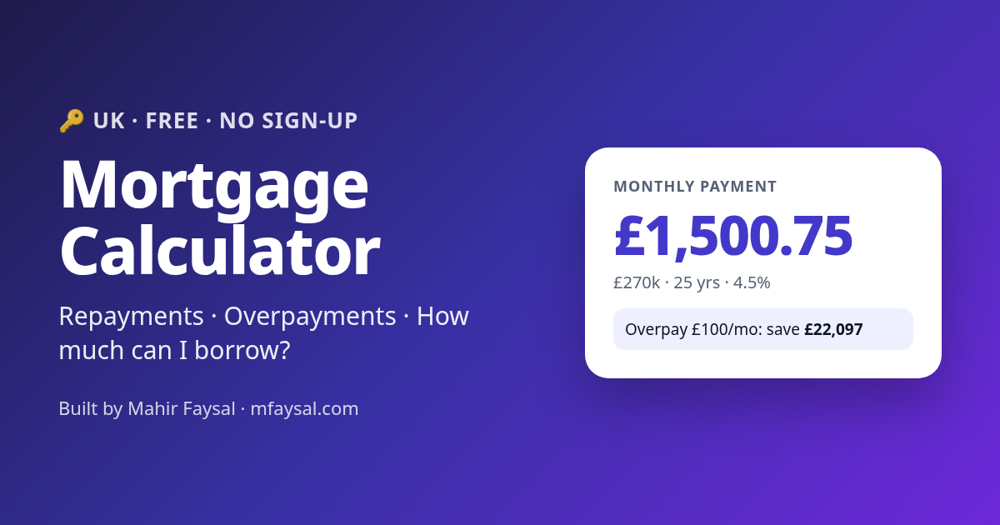

# UK Mortgage Calculator: repayments, overpayments & affordability

**Live:** https://uk-mortgage-repayment-calculator.vercel.app

A free, fast, mobile-first UK mortgage calculator. It shows your monthly repayment, total interest, a balance-over-time chart and how much overpaying saves. It also estimates how much you could borrow based on your income.



## Features
- **Repayment or interest-only** monthly payments
- Loan-to-value with UK LTV pricing tiers (95/90/85/80/75/60%)
- **Overpayments**: regular monthly overpayments and/or a one-off lump sum, showing the interest saved and the time saved, plus a warning when you go over the usual 10%-a-year allowance
- **Amortisation**: SVG balance chart (with vs without overpayments), donut chart of loan vs interest and a year-by-year schedule
- **Rate change stress test** (−1% to +3%)
- **Affordability**: single or joint income at 4×, 4.5×, 5× or 5.5× income multiples
- Shareable URLs, copy result, accessible, works in dark mode, no tracking, no API keys
- SEO: meta/OG tags, `WebApplication` + `FAQPage` JSON-LD, sitemap, and an explainer with UK FAQs

## Tech
Plain HTML, CSS and JavaScript (ES modules), with no build step and no dependencies. The maths lives in [`public/mortgage.js`](public/mortgage.js) and is unit-tested:

```bash
npm test   # node --test
```

For example, £200,000 over 25 years at 5% gives £1,169.18 a month. The tests also check that balances reconcile to zero, that capital repaid equals the loan, and that overpayments shorten the term.

> **Disclaimer:** these figures are illustrations, not a mortgage offer, and they aren't financial advice. Your home may be repossessed if you don't keep up repayments on your mortgage.

## Author
Built by **[Mahir Faysal](https://mfaysal.com)**, a web developer making free tools for the UK.
- Website and blog: [mfaysal.com](https://mfaysal.com)
- More projects: [mfaysal.com/projects](https://mfaysal.com/projects)
- Also try the [UK Stamp Duty Calculator](https://stamp-duty-calculator-england.vercel.app)

MIT licensed.
